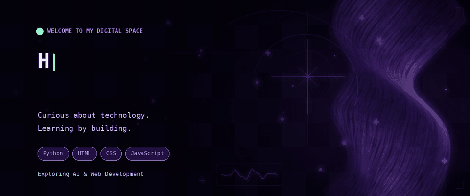

<p align="center">
  
</p>

<!-- Neon Purple Divider -->
<p align="center">
  
</p>


## whoami 👾

Not just here to write code — here to discover what code can do.

I'm Angel, a CS & IT student who loves the intersection of technology, creativity, and problem-solving. I enjoy experimenting with ideas, designing things that feel right, and figuring out the logic behind the pixels.

```python
class Angel:
    interests = ["Tech", "Design", "AI", "Problem Solving"]
    currently_building = "My next little experiment"
    mindset = "Stay curious. Keep creating."
```

When I'm not coding, I'm probably exploring a new tool, collecting ideas, or wondering how someone built something so cool.


## 🛠️ Tech Stack & Tools

<p align="center">
  
</p>

<!-- 02 | CENTERED CONTRIBUTION STREAK -->

<div align="center">
  <a href="https://github.com/angeljaiswalcg-web">
    
  </a>
</div>

<br/>


<!-- GITHUB ANALYTICS -->

<div align="center">

## 📊 `~/github-analytics`

<i>A little look at my coding journey.</i>

<br><br>

<table
  align="center"
  width="100%"
  cellpadding="8"
  cellspacing="0"
  style="border: 2px solid #C4B5FD; border-radius: 16px; background-color: #0D0718;"
>
<tr>

<td width="50%" align="center">


</td>

<td width="50%" align="center">


</td>

</tr>
</table>

</div>

---


## 🔥 Contribution Streak

<p align="center">
  
</p>
---

## 🌐 Let's Connect

<p align="center">
  <a href="YOUR_LINKEDIN_URL">
    
  </a>
  <a href="YOUR_PORTFOLIO_URL">
    
  </a>
  <a href="mailto:YOUR_EMAIL">
    
  </a>
</p>

<p align="center">
  ⭐ Thanks for visiting my profile!
</p>
